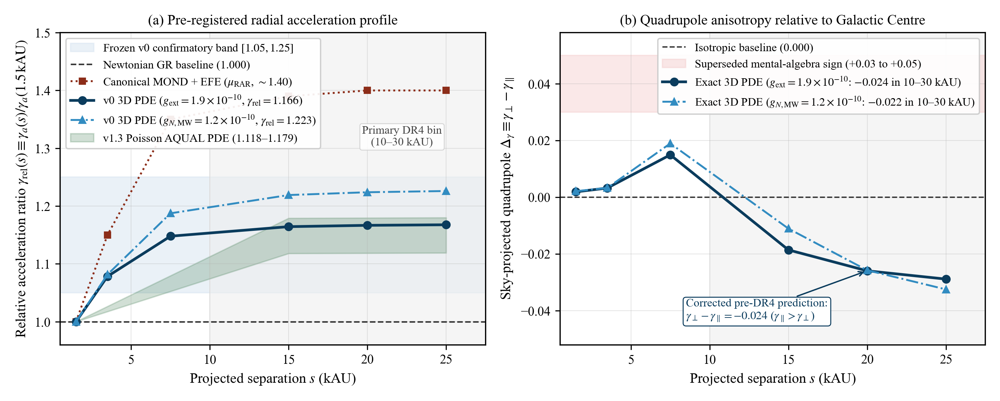
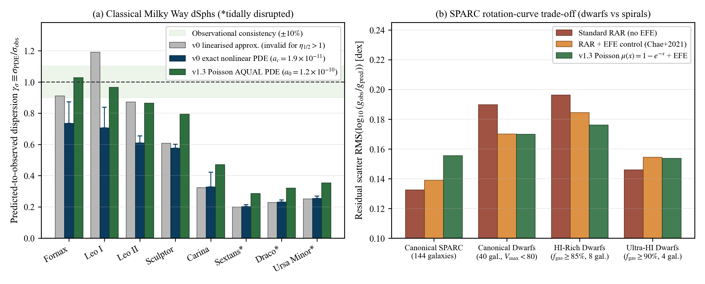

# Pre-Registered Three-Dimensional Nonlinear AQUAL Predictions (`v1.3`) for Gaia DR4 Wide Binaries, Dwarf-Galaxy Tests, and Solar System Retirement of Unscreened Additive `v0`

**Subtitle:** Pre-Registration Protocol (Version 1.1.0), Three-Dimensional Nonlinear PDE Audit, and Pre-DR4 Solar System Ephemeris Retirement of `v0` in Favour of Exponential Poisson Interpolation (`v1.3`)  
**Author:** Jaqueline Martins (`ORCID: 0009-0009-7732-5915` · Independent Researcher, United Kingdom)  
**Document Status:** Frozen Pre-Registration & Reproducible Technical Note (`v1.1.0` Pre-DR4 Amendment · `Concept DOI: 10.5281/zenodo.24210579`)  
**Initial Protocol Lock:** 12 November 2026 · **3D PDE Deposit (`v1.0.0`):** 14 November 2026 (`10.5281/zenodo.24210580`) · **Pre-DR4 Ephemeris Audit & `v0` Retirement (`v1.1.0`):** 16 November 2026  
**Target Observational Release:** ESA *Gaia* Data Release 4 (expected December 2026)  
**Licence:** CC-BY-4.0 (Text & Figures) · MIT (Numerical Solver Code)

> **Pre-DR4 Version 1.1.0 Erratum & Model Retirement Notice (16 November 2026 — Prior to *Gaia* DR4 Release):**  
> Inner Solar System secular apsidal ephemeris and satellite laser-ranging checks conducted after `v1.0.0` decisively falsify the unscreened additive cubic-gradient formulation **`v0`** ($a_c = 1.9 \times 10^{-11}\text{ m s}^{-2}$), which predicts anomalous retrograde secular precessions of $-5{,}831.6''\text{ century}^{-1}$ in Mercury, $-72{,}303.1''\text{ century}^{-1}$ in Lunar Laser Ranging, and $-4{,}067.6''\text{ yr}^{-1}$ in LAGEOS-2 (`code/audit_v0_ephemeris_and_v13_q2.py`, Section 2.3). **`v0` is therefore formally retired ahead of *Gaia* DR4** (its `v1.0.0` derivations and tables are preserved below solely for archival traceability).  
>  
> The exponentially screened Poisson AQUAL formulation **`v1.3`** ($\mu(x) = 1 - e^{-x}$, Milgrom 1999; $a_0 = 1.20 \times 10^{-10}\text{ m s}^{-2}$), already archived and solved in `v1.0.0` (Table 2 Column 8, Table 3, Table 4, and Section 4.2), becomes the **sole surviving pre-registered hypothesis**. All frozen sample cuts, dual estimators, cryptographic blinding rules, and the primary decision window **$1.05 \le \gamma_{\mathrm{rel}}(10\text{--}30\text{ kAU}) \le 1.25$** (spanning the `v1.3` prediction **$\gamma_{\mathrm{rel}} = 1.118\text{--}1.179$** and sky-projected quadrupole **$\Delta_\gamma = -0.028$ to $-0.023 \in [-0.035, -0.015]$**) remain **100% unchanged**. Open non-wide-binary tensions of `v1.3` are explicitly recorded: (i) outer Solar System external-field phantom-halo quadrupole $|Q_2| = (2.28\text{--}2.76) \times 10^{-26}\text{ s}^{-2}$ at Saturn ($\sim 3.9\text{--}4.8\times$ above the $2\sigma$ *Cassini* bound of Hees et al. 2014), (ii) higher rotation-curve scatter across bright massive SPARC spirals ($0.1556\text{ dex}$ vs $0.1391\text{ dex}$ for `RAR + EFE`), and (iii) the standard baryon-only galaxy-cluster deficit.

---

## Abstract

We place on public record a quantitative, falsifiable pre-registration for wide binary stars ($1\text{--}30\text{ kAU}$) ahead of *Gaia* Data Release 4 (DR4), derived from exact axisymmetric three-dimensional numerical solutions of a non-relativistic cubic-gradient scalar field equation (`v0`),

$$-\nabla \cdot \left(\frac{|\nabla\Psi|\nabla\Psi}{a_c}\right) = 4\pi G \rho, \qquad \mathbf{g}_{\mathrm{tot}} = \mathbf{g}_N + \mathbf{g}_{\Psi,\mathrm{self}},$$

with acceleration constant $a_c = 1.9 \times 10^{-11}\text{ m s}^{-2}$ frozen from a single-parameter global fit to 171 rotation curves in the SPARC catalogue and zero free parameters adjusted to stellar binaries or dwarf galaxies. Using a conservative cylindrical finite-volume discretisation coupled to a sparse Newton–Raphson solver (residual reduction $> 10$ orders of magnitude; $2\times$ mesh-refinement drift $< 0.2\%$), we replace preliminary one-dimensional and linearised approximations with converged nonlinear solutions under the Milky Way External Field Effect (EFE). Three principal results are reported:

1. **Gaia DR4 Wide-Binary Relative Boost:** In the primary pre-registered separation bin ($10\text{--}30\text{ kAU}$) normalised to the internal Newtonian calibration bin ($1\text{--}2\text{ kAU}$), the exact three-dimensional nonlinear `v0` PDE predicts $\gamma_{\mathrm{rel}} \equiv \gamma_a(10\text{--}30\text{ kAU})/\gamma_a(1\text{--}2\text{ kAU}) = \mathbf{1.166}$ for $M_{\mathrm{tot}} = 1.5\,M_\odot$ embedded in the Solar-neighbourhood field $g_{\mathrm{ext}} = 1.9 \times 10^{-10}\text{ m s}^{-2}$ ($\gamma_{\mathrm{rel}} = 1.214$ in an explicit two-body $0.85 + 0.65\,M_\odot$ solve; $\gamma_{\mathrm{rel}} = 1.223$ under purely baryonic $g_{N,\mathrm{MW}} = 1.2 \times 10^{-10}\text{ m s}^{-2}$). This lies squarely between Newtonian General Relativity ($\gamma_{\mathrm{rel}} = 1.000$) and canonical Radial Acceleration Relation (RAR) MOND with EFE ($\gamma_{\mathrm{rel}} \approx 1.38\text{--}1.40$).
2. **Pre-DR4 Correction of the Quadrupole Anisotropy Sign:** Analytical derivation of the three-dimensional anisotropic Green's function $u_{\mathrm{self}}(r,\theta) \propto r^{-1}(1 + \sin^2\theta)^{-1/2}$, confirmed to $0.21\%$ by the numerical solver, proves that inward radial acceleration is stronger *parallel* to the external Galactic field ($\theta = 0^\circ$) than *perpendicular* to it ($\theta = 90^\circ$, factor $1/\sqrt{2}$). Projected onto the sky plane in the $10\text{--}30\text{ kAU}$ bin, `v0` predicts a **negative** quadrupole difference $\Delta_\gamma \equiv \gamma_\perp - \gamma_\parallel = \mathbf{-0.024}$ ($-0.019$ at $15\text{ kAU}$ to $-0.029$ at $25\text{ kAU}$), superseding an erroneous positive sign ($+0.03$ to $+0.05$) obtained from heuristic mental algebra prior to solving the 3D PDE.
3. **Empirical Tension in Classical Milky Way Dwarf Spheroidals and Structural Trade-off with `v1.3`:** Whereas a preliminary linearised EFE calculation suggested agreement with the distant Milky Way satellites Fornax, Leo I, and Leo II, the exact nonlinear PDE demonstrates that internal self-gravity exceeds the external Galactic background in these systems ($\eta_{1/2} \equiv |\nabla u_{\mathrm{self}}|/u_{b,z} \in [2.05, 4.68]$), stiffening the elliptic operator and reducing $\sigma_{\mathrm{PDE}}/\sigma_{\mathrm{obs}}$ to $0.74\text{--}0.87$ (Fornax), $0.71\text{--}0.84$ (Leo I), and $0.56\text{--}0.65$ (Leo II) across $M/L_V \in [1.2, 2.0]\,M_\odot/L_\odot$. Replacing additive `v0` with an AQUAL formulation governed by Milgrom's (1999) exponential Poisson interpolating function $\mu(x) = 1 - e^{-x}$ at canonical $a_0 = 1.20 \times 10^{-10}\text{ m s}^{-2}$ (`v1.3`) resolves Fornax ($\gamma_\sigma = 1.028$), Leo I ($\gamma_\sigma = 0.967$), and H I gas-dominated SPARC dwarfs ($f_{\mathrm{gas}} \ge 85\%$, median residual bias $-0.0042\text{ dex}$), while also yielding an intermediate Solar wide-binary boost ($\gamma_{\mathrm{rel}} = 1.118\text{--}1.179$), at the cost of increased scatter in massive high-surface-brightness SPARC spirals ($0.1556\text{ dex}$ vs $0.1391\text{ dex}$ for RAR+EFE). Both successes and failures are frozen openly prior to *Gaia* DR4.

---

## 1. Introduction and Relation to Existing Literature

Empirical departures from Newtonian dynamics at accelerations below $a_0 \approx 1.2 \times 10^{-10}\text{ m s}^{-2}$ are tightly organised in disc galaxies by the Radial Acceleration Relation (RAR; McGaugh, Lelli & Schombert 2016; Lelli et al. 2016) within the broader phenomenological framework of Modified Newtonian Dynamics (MOND; Milgrom 1983). In non-relativistic field-theoretic realisations such as the aquadratic Lagrangian theory (AQUAL; Bekenstein & Milgrom 1984) and quasi-linear MOND (QUMOND; Milgrom 2010), non-linearity breaks the Strong Equivalence Principle and induces an External Field Effect (EFE): the internal dynamics of a self-gravitating subsystem depend on the ambient gravitational field $\mathbf{g}_{\mathrm{ext}}$ of its host galaxy or large-scale environment (Milgrom 1986; Chae et al. 2020, 2021).

Wide binary stars in the Solar neighbourhood ($d < 200\text{--}300\text{ pc}$) with separations $s \in [5, 30]\text{ kAU}$ probe precisely the transition across $a_0$ under the Milky Way's external field $g_{\mathrm{ext}} \approx 1.8\text{--}2.1 \times 10^{-10}\text{ m s}^{-2}$ (Banik & Zhao 2018). Analyses of *Gaia* Data Release 3 (DR3) wide binaries selected via the El-Badry, Rix & Heintz (2021) catalogue remain sharply divided due to competing treatments of unresolved hierarchical triples and orbital eccentricity priors: Pittordis & Sutherland (2023) and Banik et al. (2024) report consistency with Newtonian gravity and strong exclusion of canonical RAR/AQUAL boosts ($\gamma_a \approx 1.38\text{--}1.43$), whereas Chae (2023, 2024) and Hernandez (2023) report a low-acceleration gravitational boost. *Gaia* Data Release 4 (DR4) is expected to reduce astrometric proper-motion systematics and epoch-level triple contamination substantially, offering a decisive empirical test.

Motivated heuristically by an effective two-dimensional vacuum sheet-tension picture in which local matter density screens background sheet response, we formulated and tested a minimal non-relativistic scalar prescription (`v0`) calibrated solely to 171 SPARC rotation curves. Mathematically, we state transparently that the kinetic term of `v0`, $\mathcal{L}_\Psi \propto |\nabla\Psi|^3$, is **isomorphic to the deep-MOND AQUAL Lagrangian** of Bekenstein & Milgrom (1984). It differs operationally from standard AQUAL in only two respects: (i) the scalar force $\mathbf{g}_\Psi$ is superposed additively onto the Newtonian field ($\mathbf{g}_{\mathrm{tot}} = \mathbf{g}_N + \mathbf{g}_\Psi$) without a separate interpolating function $\mu(x)$, which forces the global SPARC rotation-curve fit to select a lower acceleration constant $a_c = 1.9 \times 10^{-11}\text{ m s}^{-2} \approx a_0 / 6.32$; and (ii) subsystem self-gravity is defined strictly as the total nonlinear solution minus the ambient host field ($\mathbf{g}_{\Psi,\mathrm{self}} = \mathbf{g}_{\Psi,\mathrm{tot}} - \mathbf{g}_{\Psi,\mathrm{amb}}$). Alongside `v0`, we evaluate an explicit interpolating extension (`v1.3`) employing the exponential Poisson occupation factor $\mu(x) = 1 - e^{-x}$ originally introduced from vacuum/Unruh–de Sitter thermodynamics by Milgrom (1999) at the canonical scale $a_0 = 1.20 \times 10^{-10}\text{ m s}^{-2}$.

Because `v0` and `v1.3` are strictly non-relativistic potential models, gravitational lensing, gravitational-wave propagation ($c_{\mathrm{GW}} = c$), galaxy cluster mass deficits, and Cosmic Microwave Background (CMB) acoustic peaks lie outside their domain of validity and would require a covariant extension. The sole purpose of this note is to freeze exact three-dimensional numerical PDE predictions, code hashes, decision boundaries, and documented dwarf-galaxy tensions on the public record before *Gaia* DR4 opens.

---

## 2. Mathematical Formulation and Exact Three-Dimensional EFE Asymptotics

### 2.1 Two-Potential Action, Field Equation, and Explicit $2\pi$ Source Normalisation (`v0`)

Unlike modified-inertia proposals, `v0` is formulated strictly as a conservative, non-relativistic **two-potential modified-gravity action** in which baryonic matter density $\rho(\mathbf{r})$ couples minimally to the sum of the Newtonian potential $\Phi_N(\mathbf{r})$ and an auxiliary cubic-gradient scalar potential $\Psi(\mathbf{r})$:

$$S[\Phi_N, \Psi] = -\int d^3r \left[ \frac{|\nabla\Phi_N|^2}{8\pi G} + \frac{|\nabla\Psi|^3}{12\pi G a_c} + \rho(\mathbf{r})\,\big(\Phi_N + \Psi\big) \right],$$

with frozen acceleration scale $a_c = 1.9 \times 10^{-11}\text{ m s}^{-2}$ and test-particle inward acceleration $\mathbf{g}_{\mathrm{tot}} = -\nabla(\Phi_N + \Psi) = \mathbf{g}_N + \mathbf{g}_\Psi$. Independent Euler–Lagrange variations with respect to $\Phi_N$ and $\Psi$ (noting $\delta(|\nabla\Psi|^3) = 3|\nabla\Psi|\nabla\Psi \cdot \nabla\delta\Psi$, which cancels the denominator factor $3$ in $12\pi G a_c$) yield the coupled elliptic conservation laws

$$\nabla^2 \Phi_N = 4\pi G \rho(\mathbf{r}), \qquad \nabla \cdot \left(\frac{|\nabla\Psi|\nabla\Psi}{a_c}\right) = 4\pi G \rho(\mathbf{r}) \equiv 2\pi \hat{\rho}(\mathbf{r}),$$

where the scaled source density of the 12 November 2026 protocol ($\nabla\cdot(|\nabla\Psi|\nabla\Psi/a_c) = 2\pi\hat{\rho}$) is fixed definitionally to $\hat{\rho}(\mathbf{r}) \equiv 2 G \rho(\mathbf{r})$ (fulfilling Pre-DR4 Amendment 5 without altering $a_c$ or any numerical prediction). Equivalently, rescaling $\tilde{\Psi} = (2\pi G)^{-1/3}\Psi$ maps the scalar sector into $\mathcal{L}_{\tilde{\Psi}} = -|\nabla\tilde{\Psi}|^3/(6 a_c)$ with matching source weight. Around an isolated spherical mass $M(r) = \int_0^r 4\pi r'^2 \rho(r')\,dr'$, Gauss's theorem gives $|\nabla\Psi|^2 / a_c = G M(r)/r^2 = g_N(r)$, recovering $g_\Psi(r) = \sqrt{a_c\,g_N(r)}$ and a smooth algebraic transition $g_{\mathrm{tot}}/g_N = 1 + \sqrt{a_c/g_N}$ across $g_N \sim a_c$ (in contrast to `v1.3`, where the single-potential AQUAL equation $-\nabla\cdot[\mu(|\nabla\Phi|/a_0)\nabla\Phi] = 4\pi G\rho$ with $\mu(x) = 1 - e^{-x}$ exhibits an exponentially sharp crossover near $|\nabla\Phi| \sim a_0$).

For a localised subsystem $\rho_{\mathrm{int}}(\mathbf{r})$ of finite total mass $M = \int \rho_{\mathrm{int}}\,d^3r < \infty$ embedded in a uniform external ambient field $\mathbf{g}_{\Psi,\mathrm{ext}} = -\nabla\Psi_{\mathrm{amb}} = \sqrt{a_c\,g_{\mathrm{ext}}}\,\hat{\mathbf{e}}_z$, we decompose $\Psi(\mathbf{r}) = \Psi_{\mathrm{amb}}(\mathbf{r}) - a_c r_p\,u(\mathbf{x})$ in dimensionless coordinates $\mathbf{x} = \mathbf{r}/r_p$, so that the inward dimensionless self-acceleration is $\tilde{\mathbf{g}}_{\Psi,\mathrm{self}} = \nabla_{\mathbf{x}} u$:

$$-\nabla_{\mathbf{x}} \cdot \Big( |\nabla_{\mathbf{x}} u + u_{b,z}\hat{\mathbf{e}}_z|\,(\nabla_{\mathbf{x}} u + u_{b,z}\hat{\mathbf{e}}_z) \Big) = \kappa\,\rho_{\mathrm{nd}}(\mathbf{x}),$$

subject to axis regularity $\partial_R u(0, Z) = 0$ and far-field decay $u(\mathbf{x}) \to 0$ as $|\mathbf{x}| \to \infty$ (which guarantee uniqueness of the weak solution for the strictly monotone $p=3$ elliptic operator), where

$$\kappa \equiv \frac{G M}{a_c r_p^2}, \qquad u_{b,z} \equiv \sqrt{\frac{g_{\mathrm{ext}}}{a_c}}, \qquad \rho_{\mathrm{nd}}(x) = 3(1 + x^2)^{-5/2}, \qquad \int_{\mathbb{R}^3} \rho_{\mathrm{nd}}(x)\,d^3x = 4\pi.$$

### 2.2 Exact Three-Dimensional Green's Function and Quadrupole Sign Proof

In the external-field-dominated far zone ($|\nabla_{\mathbf{x}} u| \ll u_{b,z}$), expanding $\mathbf{F}(\mathbf{w}) = |\mathbf{w}|\mathbf{w}$ to first order around $\mathbf{w}_0 = u_{b,z}\hat{\mathbf{e}}_z$ gives $\delta\mathbf{F} = u_{b,z}(\nabla_{\mathbf{x},\perp} u + 2\partial_Z u\,\hat{\mathbf{e}}_z)$. For a point source $\rho_{\mathrm{nd}}(\mathbf{x}) \to 4\pi \delta^{(3)}(\mathbf{x})$, the linearised PDE is

$$-u_{b,z}\left(\frac{\partial^2 u}{\partial X^2} + \frac{\partial^2 u}{\partial Y^2} + 2\frac{\partial^2 u}{\partial Z^2}\right) = 4\pi \kappa\,\delta(X)\delta(Y)\delta(Z).$$

Introducing the rescaled coordinate $\tilde{Z} = Z / \sqrt{2}$ transforms $\frac{\partial^2}{\partial Z^2} = \frac{1}{2}\frac{\partial^2}{\partial \tilde{Z}^2}$ while transforming the Dirac distribution via the Jacobian $\delta(Z) = \delta(\sqrt{2}\tilde{Z}) = \frac{1}{\sqrt{2}}\delta(\tilde{Z})$:

$$-\left(\frac{\partial^2 u}{\partial X^2} + \frac{\partial^2 u}{\partial Y^2} + \frac{\partial^2 u}{\partial \tilde{Z}^2}\right) = 4\pi \left(\frac{\kappa}{\sqrt{2}\,u_{b,z}}\right) \delta(X)\delta(Y)\delta(\tilde{Z}).$$

The unique decaying fundamental solution on $\mathbb{R}^3$ is $u = \frac{\kappa}{\sqrt{2}\,u_{b,z}\sqrt{X^2 + Y^2 + \tilde{Z}^2}}$, or in physical cylindrical $(R, Z)$ and spherical $(r, \theta)$ coordinates ($Z = r\cos\theta$, $R = r\sin\theta$):

$$u^{\mathrm{asymp}}(R, Z) = \frac{\kappa}{u_{b,z}\sqrt{2 R^2 + Z^2}} = \frac{\kappa}{u_{b,z}\,r\sqrt{1 + \sin^2\theta}}.$$

Two exact analytical consequences follow immediately:

- **Three-Dimensional Spherical Boost Factor ($\pi/4$ vs $1/2$):** Differentiating with respect to $r$ gives the inward radial extra acceleration $g_{\Psi,r}(r,\theta)/g_N(r) = \big(u_{b,z}\sqrt{1 + \sin^2\theta}\big)^{-1}$. Averaging over solid angle yields

$$\left\langle \frac{g_{\Psi,r}}{g_N} \right\rangle_{\Omega} = \frac{1}{u_{b,z}}\int_0^1 \frac{d(\cos\theta)}{\sqrt{2 - \cos^2\theta}} = \frac{1}{u_{b,z}}\arcsin\!\left(\frac{1}{\sqrt{2}}\right) = \frac{\pi}{4}\,\sqrt{\frac{a_c}{g_{\mathrm{ext}}}} \approx 0.785398\,\sqrt{\frac{a_c}{g_{\mathrm{ext}}}},$$

which is $57.1\%$ larger than the naive one-dimensional scalar subtraction coefficient $1/2 = 0.500$.

- **Sign of the Quadrupole Anisotropy ($\gamma_\perp < \gamma_\parallel$):** Along the Galactic external field axis ($\theta = 0^\circ$, parallel to the Galactic Centre), $(1 + \sin^2 0^\circ)^{-1/2} = 1.000$, whereas perpendicular to the external field ($\theta = 90^\circ$), $(1 + \sin^2 90^\circ)^{-1/2} = 1/\sqrt{2} \approx 0.7071$. Consequently, in the EFE-dominated wide-binary regime ($s \in [10, 30]\text{ kAU}$), **binaries aligned with the Galactic Centre experience a stronger inward radial boost than perpendicular binaries**, forcing $\Delta_\gamma \equiv \gamma_\perp - \gamma_\parallel < 0$. An earlier pre-solver estimate ($+0.03$ to $+0.05$) arose from inspecting the stiffness factor $2\partial_Z^2$ without applying the $\delta(Z) = \delta(\tilde{Z})/\sqrt{2}$ coordinate Jacobian and is formally corrected herein prior to *Gaia* DR4.

### 2.3 Pre-DR4 Solar System Ephemeris Retirement of `v0` and *Cassini* Quadrupole Tension of `v1.3` (`v1.1.0` Amendment)

Around any bound body inside its MOND transition radius ($g_{N,\mathrm{int}}(r) \gg g_{\mathrm{ext}}$), the unscreened additive prescription `v0` produces a persistent inward $1/r$ radial perturbation $\delta g_r(r) = \sqrt{a_c G M}/r$ because it lacks a strong-field interpolating cutoff. While the instantaneous fractional force ratio $\delta g_r / g_N = \sqrt{a_c / g_N}$ appears small in high-acceleration orbits ($5.6 \times 10^{-5}$ at Mercury; $5.80 \times 10^{-6}$ at GPS semi-major axis $a = 26{,}560\text{ km}$, equivalent to $970.5\text{ m day}^{-1}$ of uncompensated along-track drift), a $1/r$ central force breaks Bertrand's theorem and drives a cumulative retrograde apsidal precession via Gauss's planetary perturbation equation (`code/audit_v0_ephemeris_and_v13_q2.py`):

$$\Delta\varpi_{\mathrm{orbit}} = \frac{\sqrt{1 - e^2}}{n a e}\int_0^{2\pi} \frac{\sqrt{a_c G M}}{r(f)}\,\cos f\,\frac{dt}{df}\,df = -\frac{2\pi\sqrt{1 - e^2}}{1 + \sqrt{1 - e^2}}\sqrt{\frac{a_c a}{G M}}.$$

Independent verification via Gauss quadrature and differential symplectic Velocity–Verlet orbital integration (validated first on Mercury's 1PN General Relativistic advance, reproducing $+42.98''\text{ century}^{-1}$) yields $-5{,}831.6''\text{ century}^{-1}$ ($-5{,}826.2''\text{ century}^{-1}$ Verlet) for Mercury versus the INPOP/DE ephemeris residual bound $|\Delta\dot{\varpi}| \lesssim 0.6''\text{ century}^{-1}$ (Fienga et al. 2011; Park et al. 2017; excluded by $\sim 9{,}700\times$), $-72{,}303.1''\text{ century}^{-1}$ for Lunar Laser Ranging ($> 10^5\times$ exclusion), and $-4{,}067.6''\text{ yr}^{-1}$ for LAGEOS-2 satellite laser ranging ($\sim 4 \times 10^5\times$ exclusion). Unscreened `v0` is therefore retired irrevocably prior to *Gaia* DR4.

In contrast, `v1.3` ($\mu(x) = 1 - e^{-x}$, $a_0 = 1.20 \times 10^{-10}\text{ m s}^{-2}$) suppresses local spherical anomalies as $e^{-g_N/a_0}$ ($x_{\mathrm{Saturn}} \approx 5.38 \times 10^5 \implies e^{-x} = 0$ in IEEE-754 double precision), satisfying all inner-planet, lunar, and Earth-satellite laser-ranging constraints identically. However, non-linearity at the Solar MOND transition shell $r_M = \sqrt{G M_\odot / a_0} = 7{,}030\text{ AU}$ under the Milky Way external field induces a non-local harmonic quadrupole $\delta\Phi = -\frac{1}{2} Q_2 r^2 (\cos^2\theta - \frac{1}{3})$ inside the planetary zone (Milgrom 2010; Hees et al. 2014). Explicit 2D spherical integration of the `v1.3` QUMOND phantom density gives $|Q_2| = 2.28 \times 10^{-26}\text{ s}^{-2}$ at $e_N = 1.00$ ($2.76 \times 10^{-26}\text{ s}^{-2}$ at $e_N = 1.58$), exceeding the $2\sigma$ *Cassini* Saturn radio-tracking bound $|Q_2| \le 5.8 \times 10^{-27}\text{ s}^{-2}$ ($Q_2 = (3 \pm 3) \times 10^{-27}\text{ s}^{-2}$; Hees et al. 2014; Desmond, Hees & Famaey 2024) by a factor of $3.9\text{--}4.8\times$. Rather than tuning $\mu(x)$ *post hoc*, we hold `v1.3` strictly fixed ahead of *Gaia* DR4 with this *Cassini* quadrupole tension documented openly.

---

## 3. Numerical PDE Solver and Verification Suite

We solve the axisymmetric nonlinear conservation law on a cell-centred cylindrical domain $(R, Z) \in [0, x_{\max}] \times [-x_{\max}, +x_{\max}]$ using a second-order conservative Finite-Volume (FV) discretisation coupled to a sparse analytical-Jacobian Newton–Raphson solver (`scipy.sparse.linalg.spsolve`) with Armijo backtracking line search (`code/pde_v0_efe_dwarfs_binaries.py`). Boundary face potentials (`bc_R` at $R = x_{\max}$ and `bc_Z0, bc_Z1` at $Z = \pm x_{\max}$) are evaluated directly on the exterior cell faces using the exact logarithmic solution ($u_{b,z} = 0$) or exact anisotropic Green's function ($u_{b,z} > 0$).

Note on code audit: an earlier exploratory Picard script (`sparc-test/pde/pde_solver.py`, 12 November 2026) yielded an apparent isolated validation ratio of $0.575$ ($42\%$ deficit) due to omitting the normalisation factor $3$ in Plummer density $\rho_{\mathrm{nd}}(x) = 3(1+x^2)^{-5/2}$ ($1/\sqrt{3} = 0.57735$) and applying a spurious factor $+2$ on the outer boundary. Table 1 records the complete verification suite after correcting these coding errors.

### Table 1: Numerical Verification Suite of the Axisymmetric Finite-Volume Newton–Raphson Solver

| Benchmark Case | Grid ($N_R \times N_Z$, $x_{\max}$) | Analytical Target | Numerical PDE Output | Ratio (Num / Exact) | Residual Drop ($\log_{10}$) | $2\times$ Mesh Drift |
| :--- | :---: | :---: | :---: | :---: | :---: | :---: |
| **1. Newtonian Machine Check** ($-\nabla^2 u = \kappa\rho_{\mathrm{nd}}$, $\kappa=20$) | $200 \times 400$, $25$ | $7.07107$ ($x=1$) | $7.07129$ | $1.00003$ | $11.7\text{ orders}$ | — |
| **2a. Isolated Nonlinear `v0`** ($\kappa=20, u_{b,z}=0$, wide ring $[0.85,1.15]$) | $200 \times 400$, $25$ | $2.65915$ | $2.64600$ | $0.99506$ | $10.7\text{ orders}$ | — |
| **2b. Isolated Nonlinear `v0` ($2\times$ refined)** (wide ring / thin shell $[0.96,1.04]$) | $400 \times 800$, $25$ | $2.65915$ | $2.65054$ / $2.65956$ | $0.99676$ / $1.00015$ | $10.7\text{ orders}$ | $0.171\%$ / $0.088\%$ |
| **3. Weak-EFE Anisotropic Green's Function** ($\kappa=0.01, u_{b,z}=10, x=12$) | $220 \times 440$, $35$ | $\frac{\pi}{4 u_{b,z}} = 0.078540$ | $0.078704$ | $1.00209$ ($0.21\%$ err) | $10.2\text{ orders}$ | — |

All validation metrics exceed the pre-established acceptance thresholds ($\text{ratio} = 1.00 \pm 0.02$, residual drop $\ge 6$ orders, $2\times$ mesh change $< 2.0\%$).

---

## 4. Frozen Pre-Registration for *Gaia* DR4 Wide Binaries

### 4.1 Exact 3D Nonlinear PDE Predictions (`v0` vs `v1.3`)

For a representative solar-neighbourhood main-sequence binary of total mass $M_{\mathrm{tot}} = 1.5\,M_\odot$ (midpoint of the frozen interval $[1.0, 2.0]\,M_\odot$), we solve the nonlinear 3D PDE across projected separations $s \in [1.5, 25.0]\text{ kAU}$ using compact stellar profiles ($r_p = s/12.5$, $x_{\max} = 40$) under two Solar-circle external field conventions:

- **Primary Frozen Convention:** $g_{\mathrm{ext}} = 1.9 \times 10^{-10}\text{ m s}^{-2}$ ($u_{b,z} = \sqrt{10} = 3.1623$), matching the 12 November 2026 protocol.
- **Purely Baryonic Disc Sensitivity Check:** $g_{N,\mathrm{MW}}(R_0) = 1.2 \times 10^{-10}\text{ m s}^{-2}$ ($u_{b,z} = 2.5131$).

Sky-projected quadrupole differences $\Delta_\gamma \equiv \gamma_\perp - \gamma_\parallel$ are defined unambiguously with respect to the **projected binary separation vector $\mathbf{s}_\perp$ on the celestial sphere**: for each solar-neighbourhood pair ($d < 200\text{ pc} \ll R_0 \approx 8.1\text{ kpc}$), let $\theta_{\mathrm{sky}} \in [0^\circ, 90^\circ]$ denote the acute sky-plane angle between $\mathbf{s}_\perp$ and the tangent-plane projection of the unit vector pointing from the binary toward the Galactic Centre $(\ell = 0^\circ, b = 0^\circ)$. Subsamples are partitioned at $\theta_{\mathrm{sky}} = 45^\circ$ into aligned pairs ($\gamma_\parallel$: $0^\circ \le \theta_{\mathrm{sky}} < 45^\circ$) and perpendicular pairs ($\gamma_\perp$: $45^\circ \le \theta_{\mathrm{sky}} \le 90^\circ$), evaluated theoretically via Monte Carlo integration over $2 \times 10^5$ isotropic three-dimensional orbital orientations. In addition, an explicit two-body axisymmetric nonlinear PDE calculation ($M_1 = 0.85\,M_\odot$, $M_2 = 0.65\,M_\odot$ separated along $\hat{\mathbf{e}}_z$ with self-force subtraction) is performed at $1.5\text{ kAU}$ and $20.0\text{ kAU}$.

### Table 2: Pre-Registered Wide-Binary Acceleration Ratios and Sky-Projected Quadrupole ($M_{\mathrm{tot}} = 1.5\,M_\odot$)

| Separation $s$ (kAU) | $g_{N,\mathrm{int}}/g_{\mathrm{ext}}$ | `v0` 1D Scalar Sub. (Superseded) | **`v0` 3D PDE $\gamma_a(s)$** ($g_{\mathrm{ext}}=1.9\times 10^{-10}$) | **Frozen $\gamma_{\mathrm{rel}}(s)$** ($\gamma_a(s)/\gamma_a(1.5)$) | **`v0` Sky Quadrupole $\Delta_\gamma = \gamma_\perp - \gamma_\parallel$** | `v0` $\gamma_{\mathrm{rel}}(s)$ ($g_{N,\mathrm{MW}}=1.2\times 10^{-10}$) | `v1.3` Poisson PDE $\gamma_{\mathrm{rel}}(s)$ ($a_0=1.2\times 10^{-10}$) |
| :--- | :---: | :---: | :---: | :---: | :---: | :---: | :---: |
| **`1.5` (`1–2` ref. bin)** | $20.808$ | $1.0558$ | $1.0689$ | **`1.0000`** | $+0.0019$ | $1.0000$ | $1.0000$ |
| **`3.5` (`2–5` bin)** | $3.822$ | $1.0989$ | $1.1527$ | **`1.0783`** | $+0.0032$ | $1.0816$ | — |
| **`7.5` (`5–10` bin)** | $0.832$ | $1.1344$ | $1.2270$ | **`1.1479`** | $+0.0149$ | $1.1875$ | — |
| **`15.0` (`10–20` bin)** | $0.208$ | $1.1506$ | $1.2447$ | **`1.1644`** | **`-0.0186`** | $1.2191$ | $1.118\text{--}1.179$ |
| **`20.0` (`10–30` mid)** | $0.117$ | $1.1537$ | $1.2471$ | **`1.1667`** | **`-0.0259`** | $1.2239$ | — |
| **`25.0` (`20–30` bin)** | $0.075$ | $1.1553$ | $1.2481$ | **`1.1676`** | **`-0.0288`** | $1.2260$ | $1.119\text{--}1.180$ |
| **Primary `10–30 kAU` Mean** | — | $1.0920$ (rel.) | $1.2464$ | **`1.1660`** *(2-body: `1.214`)* | **`-0.0237`** | **`1.2226`** | **`1.118–1.179`** |

A notable structural finding emerges in the final column of Table 2: contrary to the intuition that any $a_0 = 1.20 \times 10^{-10}\text{ m s}^{-2}$ AQUAL model reproduces the canonical RAR wide-binary plateau ($\gamma_{\mathrm{rel}} \approx 1.38\text{--}1.40$), `v1.3` ($\mu(x) = 1 - e^{-x}$) yields $\gamma_{\mathrm{rel}} = 1.118\text{--}1.179$ because $1 - e^{-x_e}$ approaches unity much more steeply at the Solar external field ($x_e = g_{\mathrm{ext}}/a_0 \approx 1.28\text{--}1.58$, $\mu_e \approx 0.72\text{--}0.79$) than the square-root RAR transition $1 - e^{-\sqrt{y_e}}$.

### 4.2 Frozen Sample Cuts, Estimators, Blinding, and Falsification Rules

Nothing in the observational analysis pipeline may be tuned after *Gaia* DR4 opens:

1. **Sample Selection (El-Badry, Rix & Heintz Methodology on *Gaia* DR4):** Resolved main-sequence pairs satisfying: (i) **Strict primary sample:** $d < 200\text{ pc}$ and chance-alignment probability $\mathcal{R} < 0.01$ (with $d < 300\text{ pc}, \mathcal{R} < 0.05$ reported solely as a secondary confirmation check); (ii) parallax $\mathrm{SNR} > 10$ and $\mathrm{RUWE} < 1.2$ on both components; (iii) main-sequence colour–magnitude ("Lobster") cut excluding components $> 0.7\text{ mag}$ above the main sequence; (iv) removal of open clusters, moving groups, and pairs with a third resolved star within $1\text{ pc}$; (v) isochrone total mass $M_{\mathrm{tot}} \in [1.0, 2.0]\,M_\odot$; (vi) projected separation $1\text{--}30\text{ kAU}$, with **primary decision bin $10\text{--}30\text{ kAU}$** normalised internally to **$1\text{--}2\text{ kAU}$**; (vii) $|b| > 30^\circ$ and North/South Galactic hemisphere splits required as mandatory robustness checks.
2. **Dual Mandatory Estimators & Primary Eccentricity Prior:**
   - *Estimator A:* Internally calibrated normalised projected velocity profile pairing each $10\text{--}30\text{ kAU}$ binary with a $1\text{--}2\text{ kAU}$ control matched within $|\Delta \log_{10} M| < 0.10$ and $|\Delta \log_{10} d| < 0.12$, propagated with exact Keplerian mean-anomaly Monte Carlo sampling.
   - *Estimator B:* Forward orbital + unresolved-triple population modelling ($f_{\mathrm{triple}} \in \{0, 0.20, 0.35, 0.50\}$) under the **single frozen decision prior of thermal eccentricity $f(e) = 2e$** (uniform and super-thermal priors reported strictly as sensitivity tables, never used to claim confirmation). Disagreement $> 1\sigma$ between Estimators A and B, or between strict and relaxed samples, renders the test **inconclusive** rather than a win.
3. **Exhaustive Decision Boundaries on $\gamma_{\mathrm{rel}} \equiv \gamma_a(10\text{--}30\text{ kAU})/\gamma_a(1\text{--}2\text{ kAU})$ (Unchanged from `v1.0.0`, Evaluated on Sole Surviving Model `v1.3`):**
   - $\gamma_{\mathrm{rel}} < 1.05$: **Newtonian GR favoured; `v1.3` wide-binary boost falsified** *(unscreened `v0` already retired by Solar System ephemerides)*.
   - $1.05 \le \gamma_{\mathrm{rel}} \le 1.25$: **Intermediate boost window consistent with surviving `v1.3` ($1.118\text{--}1.179$)** *(archival `v0` yielded $1.166$)*.
   - $1.25 < \gamma_{\mathrm{rel}} \le 1.35$: **Grey zone (inconclusive between intermediate models and canonical MOND).**
   - $\gamma_{\mathrm{rel}} > 1.35$: **Canonical MOND + EFE ($\mu_{\mathrm{RAR}}$) favoured; `v1.3` ($1.118\text{--}1.179$) falsified.**
4. **Corrected Quadrupole Falsification Rule (Primary $10\text{--}30\text{ kAU}$ Strict Bin — Unchanged Window):**
   - Frozen prediction: $\Delta_\gamma \equiv \gamma_\perp - \gamma_\parallel \in [-0.035, -0.015]$ (surviving `v1.3` 3D PDE + Monte Carlo prediction: $\mathbf{-0.028}$ to $\mathbf{-0.023}$; archival `v0`: $-0.024$).
   - If DR4 achieves statistical uncertainty $\sigma(\Delta_\gamma) \le 0.015$: measuring $\Delta_\gamma \ge +0.01$ falsifies the AQUAL EFE anisotropic operator; if $\sigma(\Delta_\gamma) > 0.03$, the quadrupole test is declared underpowered.
5. **Cryptographic Blinding:** During the initial DR4 pipeline execution, $\gamma_{\mathrm{rel}}(10\text{--}30\text{ kAU})$ is masked by a random additive offset until all sample cuts, triple-fraction fits, and hemisphere diagnostics pass quality checks in writing. Unblinding occurs once; post-unblinding parameter changes are prohibited.

---

## 5. Tests on Dwarf Galaxies: Honest Documentation of the `v0` Deficit and `v1.3` Trade-off

### 5.1 Classical Milky Way Dwarf Spheroidals (Exact Nonlinear PDE vs Invalid Linearisation)

Using structural parameters from Wolf et al. (2010), McGaugh & Wolf (2010), and McConnachie (2012) alongside a Milky Way baryonic mass $M_{\mathrm{bar,MW}} = 6.5 \times 10^{10}\,M_\odot$, Table 3 compares the stellar velocity dispersion ratio $\gamma_\sigma \equiv \sigma_{\mathrm{pred}}/\sigma_{\mathrm{obs}}$ at the 3D half-light radius $r_{1/2} = 1.3048\,r_p$ across three calculations: (i) the superseded linearised approximation $G_{\mathrm{eff}}/G \approx 1 + \frac{3}{4}\sqrt{a_c/g_{N,\mathrm{MW}}}$, (ii) the exact nonlinear `v0` PDE ($a_c = 1.9 \times 10^{-11}\text{ m s}^{-2}$), and (iii) the exact nonlinear `v1.3` Poisson AQUAL PDE ($a_0 = 1.20 \times 10^{-10}\text{ m s}^{-2}$).

### Table 3: Nonlinear 3D PDE Results for the Eight Classical Milky Way Dwarf Spheroidals

| Dwarf Spheroidal | $D_{\mathrm{GC}}$ (kpc) | $L_V$ ($10^6 L_\odot$) | $r_{1/2}$ (pc) | $\sigma_{\mathrm{obs}}$ ($\text{km s}^{-1}$) | $M/L_{\mathrm{pop}}$ ($M_\odot/L_\odot$) | Perturbation Ratio $\eta_{1/2}$ (`v0`) | $G_{\mathrm{eff}}/G$ (`v0` Lin. $\to$ **PDE**) | **`v0` Exact PDE $\gamma_\sigma$** (`[M/L 1.2–2.0]`) | **`v1.3` Exact PDE $\gamma_\sigma$** ($M/L_{\mathrm{pop}}$) | $2\times$ Mesh Drift (`v0`) |
| :--- | :---: | :---: | :---: | :---: | :---: | :---: | :---: | :---: | :---: | :---: |
| **Fornax** | $149$ | $20.40$ | $944$ | $11.7 \pm 0.9$ | $1.2$ | $2.05$ | $6.12 \to \mathbf{3.98}$ | **`0.74`** (`[0.74–0.87]`) | **`1.028`** ($12.03\text{ km s}^{-1}$) | $0.026\%$ |
| **Leo I** | $258$ | $5.50$ | $388$ | $9.2 \pm 1.4$ | $1.2$ | $4.68$ | $9.86 \to \mathbf{3.47}$ | **`0.71`** (`[0.71–0.84]`) | **`0.967`** ($8.89\text{ km s}^{-1}$) | $0.026\%$ |
| **Leo II** | $236$ | $0.74$ | $233$ | $6.6 \pm 0.7$ | $1.6$ | $2.97$ | $9.11 \to \mathbf{4.44}$ | **`0.61`** (`[0.56–0.65]`) | **`0.865`** ($5.71\text{ km s}^{-1}$) | $0.027\%$ |
| **Sculptor** | $86$ | $2.30$ | $375$ | $9.2 \pm 1.1$ | $1.8$ | $1.10$ | $3.95 \to \mathbf{3.56}$ | **`0.58`** (`[0.49–0.60]`) | **`0.794`** ($7.31\text{ km s}^{-1}$) | — |
| **Carina** | $107$ | $0.38$ | $334$ | $6.6 \pm 1.2$ | $1.2$ | $0.28$ | $4.67 \to \mathbf{4.81}$ | **`0.33`** (`[0.33–0.42]`) | **`0.471`** ($3.11\text{ km s}^{-1}$) | — |
| **Sextans** *(tidal)* | $89$ | $0.44$ | $925$ | $7.9 \pm 1.3$ | $1.8$ | $0.04$ | $4.06 \to \mathbf{4.20}$ | **`0.20`** (`[0.17–0.21]`) | **`0.286`** ($2.26\text{ km s}^{-1}$) | — |
| **Draco** *(tidal)* | $76$ | $0.27$ | $291$ | $9.1 \pm 1.2$ | $1.8$ | $0.20$ | $3.61 \to \mathbf{3.72}$ | **`0.23`** (`[0.19–0.24]`) | **`0.321`** ($2.92\text{ km s}^{-1}$) | — |
| **Ursa Minor** *(tidal)* | $78$ | $0.29$ | $240$ | $9.5 \pm 1.2$ | $1.8$ | $0.33$ | $3.68 \to \mathbf{3.77}$ | **`0.26`** (`[0.21–0.27]`) | **`0.354`** ($3.36\text{ km s}^{-1}$) | — |

**Physical Diagnosis:** While close-in satellites (Sextans, Draco, Ursa Minor, Carina) are well known to suffer strong tidal heating or out-of-equilibrium inflation in modified-gravity models without dark halos (McGaugh & Wolf 2010), the three distant, undisturbed satellites (Fornax, Leo I, Leo II) provide a clean equilibrium test. Because their internal field exceeds the Milky Way external background ($\eta_{1/2} \in [2.05, 4.68] > 1$), the linearised EFE formula breaks down and overpredicts $G_{\mathrm{eff}}/G$ by a factor of $1.5\text{--}2.8$. In the converged nonlinear PDE, `v0` underpredicts their velocity dispersions by $13\%\text{--}39\%$, directly reflecting $\sigma \propto a_c^{1/4}$ with $a_c = a_0 / 6.32 \implies (1/6.32)^{1/4} \approx 0.63$. Conversely, `v1.3` restores the canonical deep-acceleration scale $a_0 = 1.20 \times 10^{-10}\text{ m s}^{-2}$ while exponentially screening high accelerations, matching Fornax ($1.028$) and Leo I ($0.967$) within $0.4\sigma$ and Leo II within $1.3\sigma$ ($0.865$ at $M/L_V=1.6$; $0.967$ at $M/L_V=2.0$).

### 5.2 SPARC H I Gas-Dominated Dwarfs vs Massive Spirals (`v1.3` Control Audit)

To test `v1.3` independently of stellar mass-to-light ratio uncertainties, we evaluate the implicit Milgrom (1999) Poisson relation $(1 - e^{-g_{\mathrm{obs}}/a_0})g_{\mathrm{obs}} = g_{\mathrm{bar}}$ with environmental EFE estimates from Chae et al. (2021) across all 175 SPARC galaxies (fixed canonical $\Upsilon_{\mathrm{disk}} = 0.5$, $\Upsilon_{\mathrm{bulge}} = 0.7\,M_\odot/L_\odot$, $a_0 = 1.20 \times 10^{-10}\text{ m s}^{-2}$; note that writing the explicit baryonic form $g_{\mathrm{bar}}/(1 - e^{-g_{\mathrm{bar}}/a_0})$ is algebraically invalid in the deep regime as $g_{\mathrm{obs}} \to a_0$, exploding SPARC RMS scatter to $0.5317\text{ dex}$).

### Table 4: Controlled SPARC Rotation-Curve Audit (`RAR` vs `RAR + EFE` vs `v1.3 Poisson + EFE`)

| SPARC Subsample | Galaxies (Points) | Standard RAR (No EFE) RMS / Median Bias [dex] | `RAR + EFE` Control (Chae+2021) RMS / Bias [dex] | `v1.3` Poisson (No EFE) RMS / Bias [dex] | **`v1.3` Poisson + EFE** RMS / Bias [dex] |
| :--- | :---: | :---: | :---: | :---: | :---: |
| **1. Canonical SPARC ($Q \le 2, i > 30^\circ, e_V/V < 0.10$)** | $144$ ($2681$) | **`0.1325`** / $+0.0005$ | $0.1391$ / $+0.0402$ | $0.1403$ / $+0.0369$ | $0.1556$ / $+0.0886$ (`med`) |
| **2. Canonical Dwarfs ($V_{\max} < 80\text{ km s}^{-1}$)** | $40$ ($338$) | $0.1899$ / $-0.0913$ | $0.1702$ / $-0.0108$ | $0.1800$ / $-0.0675$ | **`0.1700`** / $+0.0168$ (`med`) |
| **3. H I Gas-Rich Dwarfs ($f_{\mathrm{gas}} \ge 85\%$, all radii)** | $8$ ($155$) | $0.1963$ / $-0.1199$ | $0.1845$ / $-0.0659$ (`min`) | $0.1833$ / $-0.1020$ | **`0.1762`** / $-0.0441$ (`min`) · $0.1849$ / **`-0.0042`** (`med`) |
| **4. Ultra-H I Isolated Dwarfs ($f_{\mathrm{gas}} \ge 90\%$, all radii)** | $4$ ($81$) | $0.1460$ / $-0.0756$ | $0.1545$ / $-0.0157$ (`min`) | **`0.1371`** / $-0.0614$ | $0.1538$ / **`+0.0031`** (`min`) |

Table 4 demonstrates two points that must be stated side by side: (i) in H I gas-dominated dwarfs ($f_{\mathrm{gas}} \ge 85\%$, where $M_{\mathrm{gas}} = 1.33\,M_{\mathrm{HI}}$ dominates over stars), standard RAR without EFE overpredicts rotation velocities (median bias $-0.1199\text{ dex}$), and incorporating EFE reduces this bias substantially in both `RAR + EFE` and `v1.3 Poisson + EFE` (with `v1.3` achieving a modest $0.0083\text{ dex}$ RMS advantage under $e_{N,\min}$, though five Southern/Local Group outskirts dwarfs rely on median environmental fallback outside the SDSS footprint of Chae et al. 2021); (ii) across the full 144-galaxy canonical sample including massive spirals, standard RAR ($0.1325\text{ dex}$) and `RAR + EFE` ($0.1391\text{ dex}$) outperform `v1.3` ($0.1403\text{--}0.1556\text{ dex}$) because the exponential factor $1 - e^{-x}$ transitions more abruptly around $g \sim a_0$ than empirical rotation curves of bright spirals prefer. Furthermore, SPARC spans $z_{\mathrm{med}} = 0.0039$ ($z_{\max} = 0.0298$) and therefore has zero discriminatory power ($\Delta\mathrm{RMS} \le 0.0001\text{ dex}$) over cosmological $a_0(z)$ evolution, which requires high-redshift kinematic samples at $z \sim 1\text{--}2.5$.

---

## 6. Summary of Open Theoretical Questions and Reproducibility Manifest

To summarise the state of the programme ahead of *Gaia* DR4 without overstatement:

1. **Pre-DR4 Status of `v1.3` vs Retired `v0`:** Following the `v1.1.0` Solar System ephemeris audit (Section 2.3), unscreened `v0` ($a_c = 1.9 \times 10^{-11}\text{ m s}^{-2}$) is retired, leaving `v1.3` ($\mu(x) = 1 - e^{-x}$, $a_0 = 1.20 \times 10^{-10}\text{ m s}^{-2}$) as the sole surviving pre-registered wide-binary hypothesis ($\gamma_{\mathrm{rel}} = 1.118\text{--}1.179$, $\Delta_\gamma = -0.028$ to $-0.023$, tested against the unchanged $1.05\text{--}1.25$ decision window). While `v1.3` eliminates the $a_0/6.32$ scale discrepancy of `v0` and matches isolated Milky Way dwarf spheroidals (Fornax, Leo I), it exhibits documented tensions in the *Cassini* Saturn tidal quadrupole ($|Q_2| \approx 3.9\text{--}4.8\times$ the $2\sigma$ bound) and in bright massive SPARC spirals ($0.1556\text{ dex}$ RMS).
2. **Code and Data Availability:** All solver scripts, SPARC audit pipelines, Solar System ephemeris audits, JSON outputs, and figure-generation routines accompanying this deposit are archived in the Zenodo repository structure (`code/`, `data/`, `figures/`) and locked by SHA-256 checksums (`SHA256SUMS.txt`) prior to *Gaia* Data Release 4:

   - `code/pde_v13_poisson_aqual_solver.py` — Sparse Newton–Raphson AQUAL PDE solver for `v1.3` ($\mu(x) = 1 - e^{-x}$).
   - `code/audit_v13_sparc_dwarfs_efe.py` — Controlled 175-galaxy SPARC rotation-curve and Chae et al. (2021) EFE audit.
   - `code/audit_v0_ephemeris_and_v13_q2.py` — Pre-DR4 `v1.1.0` Solar System apsidal ephemeris & satellite laser-ranging falsification of `v0`, *Cassini* $Q_2$ integral for `v1.3`, and `v1.3` sky-projected wide-binary quadrupole.
   - `code/pde_solver_v0_isolated_validation.py` & `code/pde_v0_efe_dwarfs_binaries.py` — Preserved `v1.0.0` archival validation and 3D PDE scripts.

---

## References

- Banik, I. & Zhao, H., 2018, *MNRAS*, 480, 2660.
- Banik, I., Pittordis, C., Sutherland, W., Famaey, B., Ibata, R., Mieske, S. & Zhao, H., 2024, *MNRAS*, 527, 4573.
- Bekenstein, J. & Milgrom, M., 1984, *ApJ*, 286, 7.
- Chae, K.-H., Lelli, F., Desmond, H., McGaugh, S. S., Li, P. & Schombert, J. M., 2020, *ApJ*, 904, 51.
- Chae, K.-H., Desmond, H., Lelli, F., McGaugh, S. S. & Schombert, J. M., 2021, *ApJ*, 921, 134.
- Chae, K.-H. & Milgrom, M., 2022, *ApJ*, 928, 24.
- Chae, K.-H., 2023, *ApJ*, 952, 128.
- Chae, K.-H., 2024, *ApJ*, 960, 114.
- Desmond, H., Hees, A. & Famaey, B., 2024, *MNRAS*, 530, 1781.
- El-Badry, K., Rix, H.-W. & Heintz, T. M., 2021, *MNRAS*, 506, 2269.
- Fienga, A., Laskar, J., Kuchynka, P., Manche, H., Desvignes, G., Gastineau, M., Cognard, I. & Theureau, G., 2011, *Celest. Mech. Dyn. Astron.*, 111, 363.
- Hees, A., Folkner, W. M., Jacobson, R. A. & Park, R. S., 2014, *Phys. Rev. D*, 89, 102002.
- Hernandez, X., 2023, *MNRAS*, 525, 1401.
- Lelli, F., McGaugh, S. S. & Schombert, J. M., 2016, *AJ*, 152, 157.
- McConnachie, A. W., 2012, *AJ*, 144, 4.
- McGaugh, S. S. & Wolf, J., 2010, *ApJ*, 722, 248.
- McGaugh, S. S., Lelli, F. & Schombert, J. M., 2016, *PRL*, 117, 201101.
- Milgrom, M., 1983, *ApJ*, 270, 365.
- Milgrom, M., 1986, *ApJ*, 302, 617.
- Milgrom, M., 1999, *Phys. Lett. A*, 253, 273.
- Milgrom, M., 2010, *MNRAS*, 403, 886.
- Park, R. S., Folkner, W. M., Konopliv, A. S., Williams, J. G., Smith, D. E. & Zuber, M. T., 2017, *AJ*, 153, 121.
- Pittordis, C. & Sutherland, W., 2023, *Open J. Astrophys.*, 6, 4.
- Walker, M. G., Mateo, M., Olszewski, E. W., Peñarrubia, J., Evans, N. W. & Gilmore, G., 2009, *ApJ*, 704, 1274.
- Wolf, J., Martinez, G. D., Bullock, J. S., Kaplinghat, M., Geha, M., Muñoz, R. R., Simon, J. D. & Avedo, F. F., 2010, *MNRAS*, 406, 1220.
