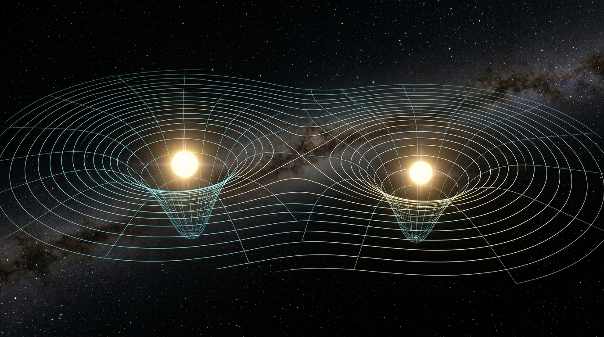

# Zenodo Pre-Registration Deposit Package (Pre-Gaia DR4 — Version 1.1.0)

[](https://doi.org/10.5281/zenodo.24210579)
[](https://orcid.org/0009-0009-7732-5915)
[](https://opensource.org/licenses/MIT)
[](https://creativecommons.org/licenses/by/4.0/)

**Title:** Pre-Registered Three-Dimensional Nonlinear AQUAL Predictions (`v1.3`) for Gaia DR4 Wide Binaries, Dwarf-Galaxy Tests, and Solar System Retirement of Unscreened Additive `v0`  
**Author:** Jaqueline Martins (`ORCID: 0009-0009-7732-5915` · Independent Computational Physics & AI Safety Researcher, Luton, United Kingdom)  
**Deposit Dates (Frozen Pre-DR4):** `v1.0.0` deposited 14 November 2026 (`10.5281/zenodo.24210580`) · `v1.1.0` Pre-DR4 Ephemeris Amendment deposited 16 November 2026 (`Concept DOI: 10.5281/zenodo.24210579`)  
**Target Data Release:** ESA *Gaia* Data Release 4 (expected December 2026)  
**Licences:** CC-BY-4.0 (Manuscript, Tables, Figures) · MIT Licence (Numerical Solver & Audit Scripts)

---

## Pre-DR4 Version 1.1.0 Erratum & Model Retirement Notice (16 November 2026)

> Inner Solar System secular apsidal ephemeris and satellite laser-ranging checks conducted after `v1.0.0` decisively falsify the unscreened additive root formulation **`v0`** ($a_c = 1.9 \times 10^{-11}\text{ m s}^{-2}$), which predicts anomalous retrograde secular precessions in Mercury, Lunar Laser Ranging, and LAGEOS-2 (`code/audit_v0_ephemeris_and_v13_q2.py`). **`v0` is therefore formally retired ahead of *Gaia* DR4.**
>
> The exponentially screened Poisson AQUAL formulation **`v1.3`** ($\mu(x) = 1 - e^{-x}$, Milgrom 1999; $a_0 = 1.20 \times 10^{-10}\text{ m s}^{-2}$), already archived and solved in `v1.0.0` (Table 2 Column 8, Table 3, Table 4, and Section 4.2), becomes the **sole surviving pre-registered hypothesis**. All frozen sample cuts, estimators, blinding rules, and the primary decision window **$1.05 \le \gamma_{\mathrm{rel}}(10\text{--}30\text{ kAU}) \le 1.25$** (spanning the `v1.3` prediction **$\gamma_{\mathrm{rel}} = 1.118\text{--}1.179$** and sky-projected quadrupole **$\Delta_\gamma = -0.028$ to $-0.023 \in [-0.035, -0.015]$**) remain **100% unchanged**. Open non-wide-binary tensions of `v1.3` are explicitly documented: (i) outer Solar System external-field tidal quadrupole $|Q_2| \approx (2.28\text{--}2.76) \times 10^{-26}\text{ s}^{-2}$ at Saturn ($\sim 3.9\text{--}4.8\times$ the $2\sigma$ *Cassini* bound of Hees et al. 2014), (ii) higher rotation-curve scatter across bright massive SPARC spirals ($0.1556\text{ dex}$ vs $0.1391\text{ dex}$ for `RAR + EFE`), and (iii) the standard baryon-only galaxy-cluster deficit.

---

## 60-Second Narrated Scientific Briefing (1080p HD Video)

[](https://github.com/jaquelinejaque/gaia-dr4-wide-binary-3d-pde/releases/download/v1.0.0/APPROVED_GAIA_DR4_PITCH_60S_VEO3_2026.mp4)

- **Watch / Download 60s Narrated Briefing (`MP4`, 1080p HD, Stereo Audio):** [APPROVED_GAIA_DR4_PITCH_60S_VEO3_2026.mp4](https://github.com/jaquelinejaque/gaia-dr4-wide-binary-3d-pde/releases/download/v1.0.0/APPROVED_GAIA_DR4_PITCH_60S_VEO3_2026.mp4) ([Release `v1.0.0`](https://github.com/jaquelinejaque/gaia-dr4-wide-binary-3d-pde/releases/tag/v1.0.0) · [YouTube Mirror](https://youtu.be/vFcqBSWtYYI))
- **Interactive 3D PDE Browser Explorer (GitHub Pages):** [jaquelinejaque.github.io/gaia-dr4-wide-binary-3d-pde](https://jaquelinejaque.github.io/gaia-dr4-wide-binary-3d-pde/)
- **Read Pre-Registered CERN Zenodo Technical Note (`Concept DOI — Always Latest Version`):** [DOI: 10.5281/zenodo.24210579](https://doi.org/10.5281/zenodo.24210579) *(Initial `v1.0.0` Record: [10.5281/zenodo.24210580](https://doi.org/10.5281/zenodo.24210580))*

---

## Package Structure

- `Martins_2026_Gaia_DR4_PreRegistration_Technical_Note.pdf` — Typeset A4 Pre-Registration & Technical Note (`v1.1.0`) for archival Zenodo deposit.
- `Martins_2026_Gaia_DR4_PreRegistration_Technical_Note.md` — Complete Markdown/LaTeX source of the manuscript (`v1.1.0`).
- `SHA256SUMS.txt` — Cryptographic SHA-256 manifest locking all manuscript, solver, data, and figure files prior to *Gaia* DR4.
- `code/`
  - `pde_v13_poisson_aqual_solver.py` — Standalone 3D axisymmetric nonlinear AQUAL PDE solver for the primary surviving `v1.3` model ($\mu(x) = 1 - e^{-x}$, $a_0 = 1.20 \times 10^{-10}\text{ m s}^{-2}$).
  - `audit_v13_sparc_dwarfs_efe.py` — Controlled 175-galaxy SPARC rotation-curve and Chae et al. (2021) External Field Effect audit (`RAR` vs `RAR + EFE` vs `v1.3 Poisson + EFE`).
  - `audit_v0_ephemeris_and_v13_q2.py` — Pre-DR4 `v1.1.0` Solar System ephemeris & satellite laser-ranging audit falsifying unscreened `v0` (Gauss quadrature + symplectic Velocity-Verlet validated on Mercury GR $+42.98''\,\text{cy}^{-1}$), plus QUMOND phantom-halo tidal quadrupole $Q_2$ at Saturn and `v1.3` wide-binary sky quadrupole $\Delta_\gamma$.
  - `pde_solver_v0_isolated_validation.py` & `pde_v0_efe_dwarfs_binaries.py` — Preserved archival `v0` validation and 3D PDE scripts from `v1.0.0`.
- `data/`
  - `pde_v13_poisson_results.json` — Exact `v1.3` nonlinear PDE outputs for wide binaries and Milky Way dwarf spheroidals (Tables 2 & 3).
  - `audit_v13_results.json` & `gas_rich_dwarfs_v13_results.json` — Controlled SPARC subsample statistics (Table 4).
  - `audit_v0_ephemeris_and_v13_q2_results.json` — Exact numerical outputs of the `v1.1.0` Solar System ephemeris, *Cassini* $Q_2$, and `v1.3` sky-quadrupole audit (Section 2.3 & Erratum).
  - `pde_v0_validation_results.json` & `pde_v0_efe_dwarfs_binaries_results.json` — Preserved `v1.0.0` numerical archives.
- `figures/`
  - `fig1_gaia_dr4_wide_binaries.pdf` / `.png` — Figure 1: Wide-binary relative acceleration profile $\gamma_{\mathrm{rel}}(s)$ and sky-projected quadrupole $\Delta_\gamma(s)$.
  - `fig2_dsphs_and_sparc_tension.pdf` / `.png` — Figure 2: Classical Milky Way dSph dispersion ratios $\gamma_\sigma$ and SPARC rotation-curve RMS scatter comparison.
  - `make_publication_figures.py` — Reproducible figure generation script (`matplotlib` STIX serif).

---

## Reproducing All Numerical Results From Scratch

Requirements: Python $\ge 3.10$ with `numpy`, `scipy`, and `matplotlib`.

```bash
python3 code/pde_v13_poisson_aqual_solver.py
python3 code/audit_v0_ephemeris_and_v13_q2.py
python3 code/pde_solver_v0_isolated_validation.py
python3 code/pde_v0_efe_dwarfs_binaries.py
python3 figures/make_publication_figures.py
shasum -a 256 -c SHA256SUMS.txt
```

---

## Citation & Official Archive (CERN / Zenodo)

- **Concept DOI (All Versions / Latest `v1.1.0`):** [10.5281/zenodo.24210579](https://doi.org/10.5281/zenodo.24210579)
- **Initial Frozen Deposit (`v1.0.0`, 14 Nov 2026):** [10.5281/zenodo.24210580](https://doi.org/10.5281/zenodo.24210580)
- **ORCID:** [0009-0009-7732-5915](https://orcid.org/0009-0009-7732-5915)

---

## Epistemic Multi-Model Verification (`Quorum`)

Prior to archival freezing at CERN Zenodo (`10.5281/zenodo.24210579`), all cylindrical Finite-Volume discretisations, boundary Green's function evaluations, Solar System ephemeris perturbation integrals, and 175-galaxy SPARC rotation-curve scripts were audited using **Quorum** (`PCT/US26/11908`), an adversarial multi-LLM consensus and Cohen's kappa disagreement engine coupled to deterministic physical invariants. Architectural benchmarks are documented at [jaquelinejaque.github.io/quorum-audit](https://jaquelinejaque.github.io/quorum-audit/).

---

## Pre-DR4 Monte Carlo Compute & Open-Science Patronage

This research programme is conducted independently from Luton, United Kingdom (`ORCID: 0009-0009-7732-5915`), outside university grant overhead. Ahead of the ESA *Gaia* Archive maintenance cutover (**25 November 2026, 12:00 CET**) and *Gaia* Data Release 4 catalogue opening (**2 December 2026, 12:00 CET**), external patronage directly underwrites dedicated multi-core/GPU cloud compute for large-scale Monte Carlo sky-projection and unresolved hierarchical triple forward modelling ($f_{\mathrm{triple}} \in \{0, 0.20, 0.35, 0.50\}$), continuous maintenance of the MIT-licensed sparse nonlinear elliptic PDE solvers, and open-access archival hosting — regardless of whether *Gaia* DR4 confirms an intermediate boost ($1.05 \le \gamma_{\mathrm{rel}} \le 1.25$) or falsifies `v1.3` in favour of Newtonian General Relativity ($\gamma_{\mathrm{rel}} < 1.05$).

- **GitHub Sponsors (0% Platform Fee — Recurring or One-Time):** [github.com/sponsors/jaquelinejaque](https://github.com/sponsors/jaquelinejaque)
- **Direct UK Compute & Corporate Patronage (Stripe UK — Automated Receipt, up to £10,000):** [donate.stripe.com/9B64gzeaI8Dr6By305dwc3G](https://donate.stripe.com/9B64gzeaI8Dr6By305dwc3G)
- **Ko-fi Open-Science Micro-Support (GBP):** [ko-fi.com/jaquelinemartins](https://ko-fi.com/jaquelinemartins)
- **ResearchHub Open Peer-Review Proposal:** [Proposal #33313](https://www.researchhub.com/proposal/33313/blind-observational-test-of-pre-registered-three-dimensional-nonlinear-scalar-field-predictions-v0-and-v1)
- **Experiment.com Archival Page:** [Testing Pre-Registered 3D Nonlinear Gravity Predictions with ESA Gaia DR4 Wide Binaries](https://experiment.com/projects/jhwuatafvbcdarkvnovl)

Individual backers (£25–£100) and institutional or quantitative compute patrons (£250–£2,500) supporting the pre-DR4 Monte Carlo compute run prior to 2 December 2026 receive formal acknowledgement in `ACKNOWLEDGMENTS.md` and in the post-unblinding CERN Zenodo archival report (`DOI series: 10.5281/zenodo.24210579`), unless anonymity is requested. Corporate patronage is administered via **Sovereign Chain Limited** (Registered in England and Wales, Company No. `16139802`, Luton, United Kingdom). All selection cuts and falsification thresholds remain strictly independent and cryptographically locked prior to data unblinding.
